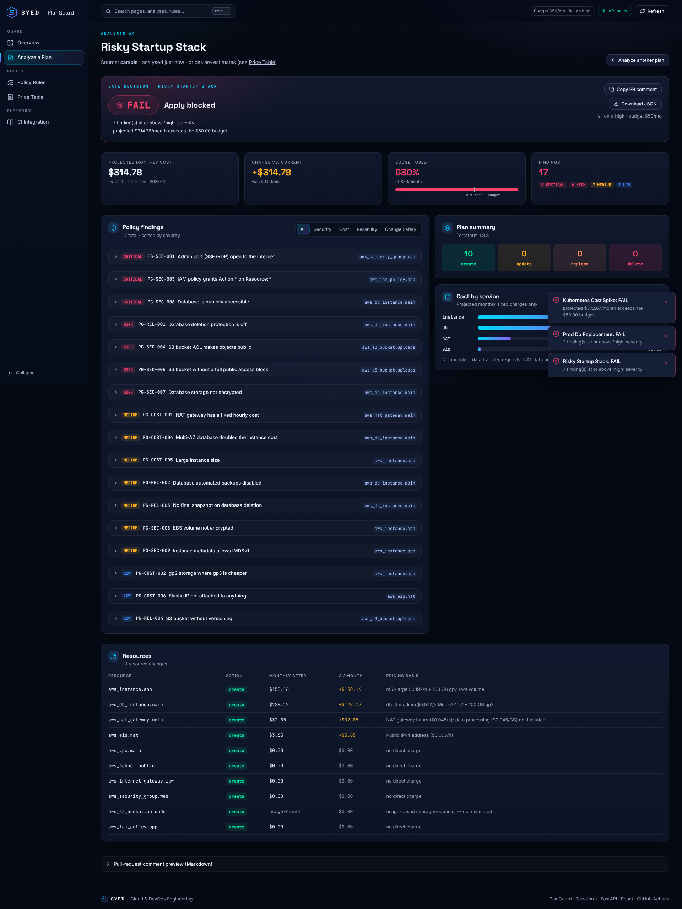
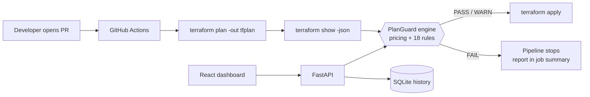

<div align="center">


# SYED PlanGuard

**Terraform Cost & Risk Gate**

*Catch the AWS bill and the security hole before `terraform apply`.*


</div>



## The problem

Most cloud surprises are written in Terraform before they ever reach AWS:

- An **SSH port open to `0.0.0.0/0`**, a **public database** or an **`Action: "*"` IAM policy** gets merged because the plan output is 400 lines long and nobody reads it.
- A **NAT gateway** (≈ $33/month even when idle), an **EKS cluster** ($73/month before a single node) or a **Multi-AZ database** quietly multiplies the bill. Students and small teams find out at the end of the month.
- A "small" change forces **replacement of a production database** or **deletes a bucket**, and `terraform apply` does exactly what it was told.

`terraform plan` shows *what* will change. It does not say whether the change is **safe** or **affordable**.

## What PlanGuard does

PlanGuard reads the machine-readable plan (`terraform show -json`) and answers one question for the pipeline: **PASS**, **WARN** or **FAIL**.

| Capability | Details |
|---|---|
| **Monthly cost estimate** | Before, after and delta per resource and per service, from a documented us-east-1 list-price table. Usage-based services are marked as such instead of being guessed. |
| **18 policy-as-code rules** | Security (open admin ports, public DBs, wildcard IAM, public S3, encryption, IMDSv2), cost (NAT, EKS, Multi-AZ, oversized instances, gp2, idle EIPs), reliability (deletion protection, backups, snapshots, versioning) and **change safety** (destroying stateful resources). Each rule has a stable ID, a remediation and a reference. |
| **Budget guardrail** | Fails the plan when the projected monthly cost exceeds your budget (default $50, sized for a student account). |
| **CLI + GitHub Action** | `python -m planguard plan.json` with exit codes for any CI. Also a composite action that writes a Markdown report to the job summary. |
| **Dashboard** | Analyse sample, pasted or uploaded plans. Includes a full report, history, a rule catalog, a price table and a copy-ready PR comment. |

### Decision policy

| Result | When |
|---|---|
| **FAIL** | any finding at or above `--fail-on` (default `high`), **or** projected cost above the budget |
| **WARN** | medium findings, **or** cost at ≥ 80 % of the budget, **or** resources that could not be priced |
| **PASS** | otherwise |

Exit codes: `0` = PASS/WARN, `1` = FAIL, `2` = invalid input.

## Architecture



The engine (`backend/planguard/`) is plain Python with **no third-party dependencies**: `plan.py` parses, `pricing.py` estimates, `rules.py` checks, `analyzer.py` decides and `render.py` formats. FastAPI is only needed for the dashboard.

## Quick start (Windows, no Docker)

```powershell
# API
cd backend
py -3.12 -m venv .venv
.venv\Scripts\Activate.ps1
pip install -r requirements-dev.txt
uvicorn planguard.api:app --port 8100

# Dashboard (second terminal)
cd frontend
npm install
npm run dev            # http://localhost:5174
```

Analyse your own Terraform:

```bash
terraform plan -out tfplan
terraform show -json tfplan > plan.json
python -m planguard plan.json --budget 50 --fail-on high            # text
python -m planguard plan.json --format markdown > comment.md        # PR comment
```

### In GitHub Actions

```yaml
- run: terraform plan -out tfplan && terraform show -json tfplan > plan.json
- uses: syedshah7214/syed-planguard@main
  with:
    plan-file: plan.json
    budget: "50"
    fail-on: high
```

## How this repository tests itself

`.github/workflows/ci.yml` runs:

1. **Engine and API**: ruff, pytest with an 85 % coverage gate, pip-audit
2. **Dashboard**: ESLint (zero warnings), TypeScript build, npm audit
3. **Real Terraform plans**: `terraform plan` on `examples/terraform/secure` and `examples/terraform/insecure`. It uses placeholder credentials and skips account lookups, so no AWS account is touched. PlanGuard **must pass** the secure plan and **must fail** the insecure one.
4. **Secret scanning** with gitleaks

## Cost model: read this

Prices are AWS **on-demand list prices for us-east-1**, checked in November 2026 (see the Price Table page or `pricing.py`). Estimates **exclude** data transfer, requests, NAT data processing, load-balancer LCUs, CPU credits, backups, taxes and discounts. They are meant to catch order-of-magnitude surprises. They are not a replacement for the AWS Pricing Calculator.

## Test results (local, 26 Nov 2026)

| Check | Result |
|---|---|
| `pytest` | ✅ 24 passed, 93 % coverage |
| `ruff check` / `ruff format --check` / `pip-audit` | ✅ clean |
| `npm run lint` / `tsc` / `vite build` / `npm audit` | ✅ |
| All 4 sample plans give the expected decision (1 PASS, 3 FAIL) | ✅ |
| Browser QA at 1920×1080, 1366×768 and 390 px: no horizontal overflow; invalid JSON shows a clear error | ✅ |
| `terraform plan` on the example configs | ⏳ runs in GitHub Actions (Terraform could not be downloaded in the build sandbox) |

## Sample plans

`backend/planguard/samples/*.json` are **hand-written** in the official Terraform JSON plan format (generated by `scripts/build_samples.py`), so the dashboard works offline. They are labelled as samples in the UI. The real-plan path is exercised by CI on `examples/terraform/`.

| Sample | Expected | Why |
|---|---|---|
| risky-startup-stack | FAIL | SSH open to the world, public unencrypted DB, `*:*` IAM, public bucket, $315/month |
| student-lab-secure | PASS | t3.micro, encrypted, IMDSv2, private bucket, ≈ $8/month |
| prod-db-replacement | FAIL | replaces a production database and deletes a bucket |
| kubernetes-cost-spike | FAIL | secure, but ≈ $373/month against a $50 budget |

## Limitations and roadmap

- AWS only, and only the resource types in the price table. Others are reported as *unpriced* and raise a WARN.
- Rules see the plan, not your live account (no drift detection).
- Roadmap: OPA/Rego policy packs, Infracost-style usage files, PR comments via the GitHub API, Azure/GCP pricing.

## Author

**Syed Masum Ali** · Aspiring DevOps engineer · *SYED | Cloud & DevOps Engineering* · [@syedshah7214](https://github.com/syedshah7214)
Companion project: [SYED ReleaseGuard](https://github.com/syedshah7214/syed-releaseguard). ReleaseGuard gates **releases** with SLOs, and PlanGuard gates **infrastructure** with cost and policy.
